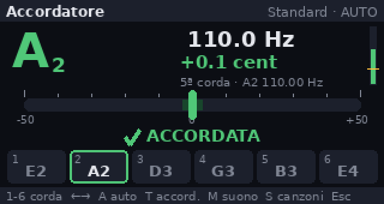
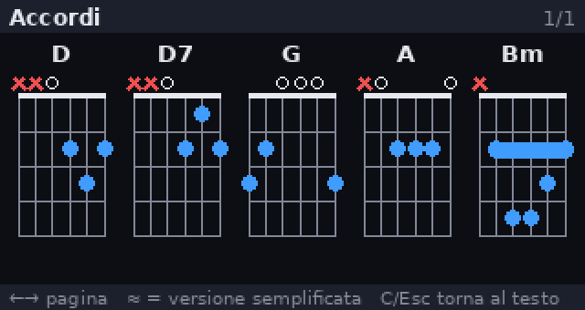

# chords-CP0 — accordatore e canzoniere per M5Stack CardputerZero

Accordatore per chitarra con canzoniere, come app del launcher (APPLaunch) di [M5Stack CardputerZero](https://docs.m5stack.com/).

| | |
|---|---|
|  |  |
|  |  |

## Cosa fa

- **Accordatore.** Ascolta la chitarra dal microfono del device e mostra nota, scarto in cent e se tendere o allentare. Suona un "ding" quando la corda è intonata. Riconosce la corda da solo oppure la scegli con i tasti 1-6. Accordature: Standard, Drop D, mezzo tono sotto, Open G, DADGAD. Nomi delle note in anglosassone o in italiano.
- **Canzoniere.** Testi con gli accordi sopra, da file ChordPro o da `.txt` copiati dai siti di accordi. Trasposizione, scorrimento automatico, diagrammi degli accordi, accordi in notazione italiana (Do, Lam, SIb…). Il comando `converti-canzone` trasforma un PDF di accordi in `.txt`.

## Installazione rapida

Nel terminale del CardputerZero (o via SSH):
```
cd ~/Downloads
git clone https://github.com/parri-ai/chords-CP0.git
cd chords-CP0/accordatore
sudo sh installa.sh
```
Se git manca: `sudo apt install git`. Oppure, senza git: *Code → Download ZIP*, copia lo zip in `~/Downloads`, poi `unzip -o chords-CP0-main.zip` e `cd chords-CP0-main/accordatore`.

Tasti, formati delle canzoni, impostazioni e soluzione dei problemi sono nel **[manuale](accordatore/LEGGIMI.md)**.

## Stato

Provata su un solo CardputerZero, con il sistema e il launcher originali. Su altri esemplari il microfono potrebbe chiamarsi in un altro modo: il manuale spiega come sceglierlo. Le segnalazioni sono benvenute.

## Struttura

| Cartella | Contenuto |
|---|---|
| `accordatore/` | l'app e gli script di installazione |
| `canzoni/` | 10 brani extra di pubblico dominio, con accordi da fonti a licenza libera |
| `docs/` | schermate |

## Licenza

Il codice è distribuito con licenza [MIT](LICENSE), © 2026 Chords.

La cartella `canzoni/` non è coperta dalla licenza MIT del codice: 6 brani sono CC BY-SA 4.0 (accordi da Wikibooks) e 4 sono MIT di Cardinote Inc. I dettagli sono in [canzoni/LEGGIMI.md](canzoni/LEGGIMI.md).

Progetto non ufficiale, non affiliato a M5Stack.

---

## English

Guitar tuner and songbook app for the **M5Stack CardputerZero** launcher (APPLaunch). The interface is in Italian.

- **Tuner:** detects the pitch from the built-in microphone (YIN algorithm) and shows note, cents and tune up/down. It plays a chime when the string is in tune. Auto string detection or manual selection with keys 1-6. Tunings: Standard, Drop D, half step down, Open G, DADGAD.
- **Songbook:** lyrics with chords from ChordPro files or plain "chords over lyrics" text files. Transpose, auto-scroll, chord diagrams, Italian chord names. A `converti-canzone` command converts chord-sheet PDFs to text.

**Install** (on the device): clone the repository (or download the ZIP), then `cd accordatore && sudo sh installa.sh`. The script installs the apt dependencies (`python3-numpy`, `python3-pil`, `alsa-utils`, `poppler-utils`) and adds the launcher icon. Test it without a guitar: `python3 /usr/share/APPLaunch/apps/accordatore/tuner.py --selftest`. Remove it with `sudo sh disinstalla.sh`.

**Status:** tested on one CardputerZero unit only.

**License:** code under the [MIT license](LICENSE), © 2026 Chords. The `canzoni/` folder is licensed separately: 6 songs under CC BY-SA 4.0 (chords from Wikibooks) and 4 under the MIT license of Cardinote Inc. See [canzoni/LEGGIMI.md](canzoni/LEGGIMI.md). Unofficial project, not affiliated with M5Stack.
