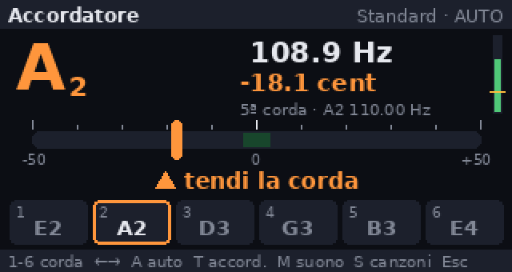
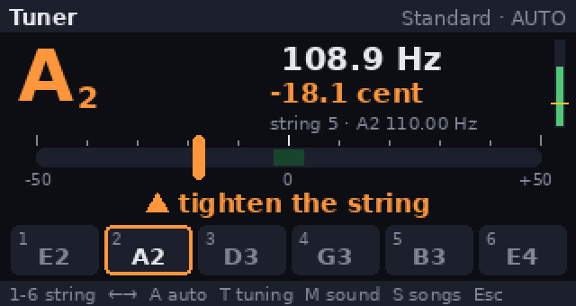
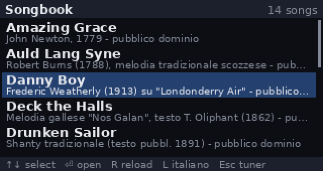

# chords-CP0 — accordatore e canzoniere per M5Stack CardputerZero

Accordatore per chitarra con canzoniere, come app del launcher (APPLaunch) di [M5Stack CardputerZero](https://docs.m5stack.com/).

| | |
|---|---|
|  |  |
|  |  |

## Cosa fa

- **Accordatore.** Ascolta la chitarra dal microfono del device e mostra nota, scarto in cent e se tendere o allentare. Suona un "ding" quando la corda è intonata. Riconosce la corda da solo oppure la scegli con i tasti 1-6. Accordature: Standard, Drop D, mezzo tono sotto, Open G, DADGAD. Nomi delle note in anglosassone o in italiano.
- **Canzoniere.** Testi con gli accordi sopra, da file ChordPro o da `.txt` copiati dai siti di accordi. Trasposizione, scorrimento automatico, diagrammi degli accordi, accordi in notazione italiana (Do, Lam, SIb…). Il comando `converti-canzone` trasforma un PDF di accordi in `.txt`.
- **Italiano o inglese.** L'interfaccia è in italiano; con il tasto `L` passa all'inglese (e viceversa) e la scelta viene ricordata.

## Installazione rapida

Nel terminale del CardputerZero (o via SSH):
```
cd ~/Downloads
git clone https://github.com/parri-ai/chords-CP0.git
cd chords-CP0/accordatore
sudo sh installa.sh
```
Se git manca: `sudo apt install git`. Oppure, senza git: *Code → Download ZIP*, copia lo zip in `~/Downloads`, poi `unzip -o chords-CP0-main.zip` e `cd chords-CP0-main/accordatore`.

Tasti, formati delle canzoni, impostazioni e soluzione dei problemi sono nel **[manuale](accordatore/LEGGIMI.md)**.

## Le tue canzoni

Il canzoniere legge tutti i file che metti in `~/canzoni`, anche nelle sottocartelle. Al primo avvio la cartella contiene 4 esempi; il resto lo aggiungi tu.

1. **Prepara il file**, in uno di questi formati (UTF-8; va bene anche la codifica di Windows):
   - **`.txt` con gli accordi sopra il testo**, come nei siti di accordi: copi e incolli così com'è; il titolo è il nome del file. Intestazioni come `[Ritornello]` e intavolature vengono riconosciute da sole.
     ```
     G            C
     Prima riga del testo
     D            G
     seconda riga del testo
     ```
   - **ChordPro** (`.cho`, `.chopro`, `.chordpro`, `.pro`, `.crd`), con gli accordi tra quadre dentro il testo:
     ```
     {title: La mia canzone}
     {artist: Io}
     [G]Prima riga del [C]testo
     [D]seconda riga del [G]testo
     ```
   - **PDF di accordi** con testo vero, non scansioni: `converti-canzone ~/Downloads/brano.pdf` lo trasforma in `.txt` e lo salva in `~/canzoni`.

   Gli accordi possono essere in anglosassone (C, Am, F#7) o in italiano (Do, Lam, Fa#7, SIb).
2. **Copialo sul device**, in `~/canzoni` o in una sua sottocartella: per esempio dal computer con `scp brano.cho pi@<indirizzo-del-cardputer>:~/canzoni/`, oppure spostandolo da `~/Downloads` con `mv ~/Downloads/brano.cho ~/canzoni/`.
3. **Nel canzoniere premi `R`** per ricaricare l'elenco.

Per controllare come viene letto un file: `python3 /usr/share/APPLaunch/apps/accordatore/songbook.py --check ~/canzoni/brano.cho`.

Le canzoni che aggiungi restano solo sul tuo device. Testi e accordi presi dai siti sono di solito protetti da diritto d'autore: tienili per uso personale e non proporli per questo repository. Qui entrano solo brani di pubblico dominio con accordi a licenza libera.

## Stato

Provata su un solo CardputerZero, con il sistema e il launcher originali. Taratura controllata con un La a 440 Hz da un generatore di toni: l'accordatore segna 440,0 Hz (errore sotto 0,2 cent); come misura e come controllarla è spiegato nel manuale. Su altri esemplari il microfono potrebbe chiamarsi in un altro modo: il manuale spiega come sceglierlo. Le segnalazioni sono benvenute.

## Struttura

| Cartella | Contenuto |
|---|---|
| `accordatore/` | l'app e gli script di installazione |
| `canzoni/` | 10 brani extra di pubblico dominio, con accordi da fonti a licenza libera |
| `docs/` | schermate |

## Licenza

Il codice è distribuito con licenza [MIT](LICENSE), © 2026 Chords.

La cartella `canzoni/` non è coperta dalla licenza MIT del codice: 6 brani sono CC BY-SA 4.0 (accordi da Wikibooks) e 4 sono MIT di Cardinote Inc. I dettagli sono in [canzoni/LEGGIMI.md](canzoni/LEGGIMI.md).

Progetto non ufficiale, non affiliato a M5Stack.

---

## English

Guitar tuner and songbook app for the **M5Stack CardputerZero** launcher (APPLaunch).

**English interface:** the app starts in Italian; press **`L`** in the tuner or in the song list to switch to English. The choice is saved (`"lingua": "en"` in `~/.config/accordatore/impostazioni.json`). The documentation, the install messages and the command-line tools are in Italian only.

| | |
|---|---|
|  |  |

- **Tuner:** detects the pitch from the built-in microphone (YIN algorithm) and shows note, cents and tune up/down. It plays a chime when the string is in tune. Auto string detection or manual selection with keys 1-6. Tunings: Standard, Drop D, half step down, Open G, DADGAD.
- **Songbook:** lyrics with chords from ChordPro files or plain "chords over lyrics" text files. Transpose, auto-scroll, chord diagrams, Italian chord names. A `converti-canzone` command converts chord-sheet PDFs to text.

**Keys.** Tuner: `1`-`6` pick a string (1 = low E, on the left), `←` `→` previous/next string, `A` auto string detection, `T` tuning, `N` note names (E A D / Mi La Re), `M` sound on/off, `S` songbook, `L` language, `Esc` quit. Songbook: `↑` `↓` select or scroll, `Enter` open, `R` reload, `S`/`G` transpose up/down, `A` auto-scroll, `1`-`9` speed, `C` chord diagrams, `N` chord names, `F` text size, `T` tuner, `L` language, `Esc` back.

**Install** (on the device): clone the repository (or download the ZIP), then `cd accordatore && sudo sh installa.sh`. The script installs the apt dependencies (`python3-numpy`, `python3-pil`, `alsa-utils`, `poppler-utils`) and adds the launcher icon. Test it without a guitar: `python3 /usr/share/APPLaunch/apps/accordatore/tuner.py --selftest`. Remove it with `sudo sh disinstalla.sh`.

**Your own songs:** put ChordPro (`.cho`) or "chords over lyrics" `.txt` files in `~/canzoni` (subfolders are fine), then press `R` in the song list. `converti-canzone file.pdf` turns a text-based chord PDF into a `.txt` file there. Your songs stay on your device; please do not submit copyrighted songs to this repository.

**Status:** tested on one CardputerZero unit only.

**Calibration:** reference A4 = 440 Hz, equal temperament (configurable with `"a4"`). Pitch is found with the YIN algorithm on 4096-sample windows at 44.1 kHz, 15 times per second, with sub-sample interpolation; the display shows the median of the last 5 readings, and "in tune" means within ±3 cents for 1 second. There is no per-device calibration: frequency depends on the audio codec's sample clock. On the tested unit a 440 Hz reference tone reads 440.0 Hz (error below 0.2 cents). To check yours, play a reference tone your speaker reproduces well (e.g. 329.63 Hz, high E) and read the Hz value; if there is a constant offset of x cents, set `a4 = 440 × 2^(x/1200)`.

**License:** code under the [MIT license](LICENSE), © 2026 Chords. The `canzoni/` folder is licensed separately: 6 songs under CC BY-SA 4.0 (chords from Wikibooks) and 4 under the MIT license of Cardinote Inc. See [canzoni/LEGGIMI.md](canzoni/LEGGIMI.md). Unofficial project, not affiliated with M5Stack.
